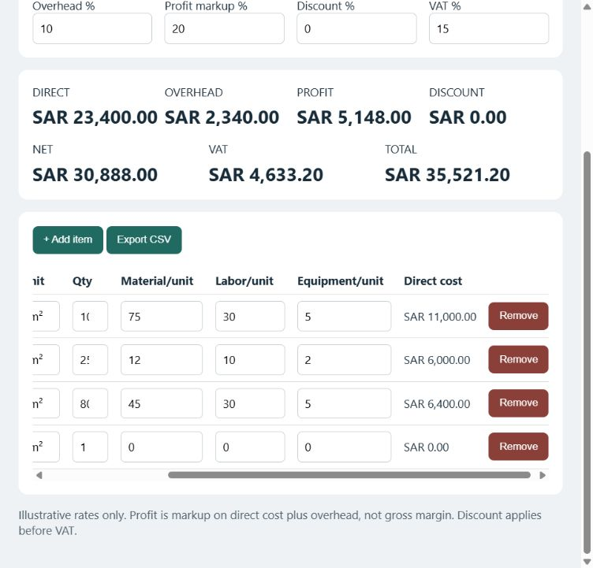

# BuildCost
A browser-based construction bill of quantities and pricing calculator. Open index.html in a modern browser, or publish the files with GitHub Pages. No dependencies or server required.

[Open the live demo](https://ameer93emad-dev.github.io/construction-boq-tool/)

## Try the demo

In the starting estimate, change porcelain flooring from 100 to 101 m². At the sample rates, direct cost rises by SAR 110 and the total including VAT changes from SAR 35,521.20 to SAR 35,688.18.

## Features
Editable BOQ, separate material/labor/equipment unit rates, overhead, profit markup, discount, VAT, and CSV export. Sample rates are synthetic and expressed in SAR. Edits are held in memory until the page is closed or refreshed; export to retain a record.

## Calculation
Direct cost = quantity × sum of unit rates. Overhead is applied to direct cost. Profit markup is applied to direct cost plus overhead. Discount is applied before VAT. VAT is applied to the discounted subtotal. This is an estimating aid, not tax or tender advice.

## Contributing
Issues and pull requests are welcome. Use synthetic data and avoid publishing confidential tender information.

## License
MIT.
